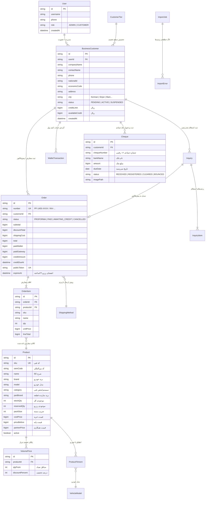

# مدل داده و دیاگرام موجودیت‌ها (Database ERD & Schema)
## پایگاه داده رابطه‌ای PostgreSQL سامانه کاردو B2B

---

## ۱. دیاگرام روابط موجودیت‌ها (Entity Relationship Diagram)

---

## ۲. ایندکس‌های تخصصی پایگاه داده برای مقیاس‌پذیری (Indexing Strategy)
برای تضمین سرعت پاسخگویی زیر ۱۰۰ میلی‌ثانیه برای ۱۰ تا ۵۰ هزار قطعه:
1. `CREATE INDEX idx_products_sku ON "Product" ("sku");` — جستجوی فوری با کد فنی و بارکد.
2. `CREATE INDEX idx_products_fitment ON "Product" ("brand", "model", "category");` — فیلترهای چندبعدی ترکیبی.
3. `CREATE INDEX idx_products_part_brand ON "Product" ("partBrand");` — فیلتر تفکیکی پارت‌برند (ایساکو، عظام، والئو).
4. `CREATE INDEX idx_orders_customer_status ON "Order" ("customerId", "status");` — واکشی سریع فاکتورهای هر مشتری.
5. `CREATE INDEX idx_orders_expires_at ON "Order" ("expiresAt") WHERE "status" = 'PROFORMA';` — روبش خودکار و آزادسازی پیش‌فاکتورهای منقضی توسط Worker پس‌زمینه.
